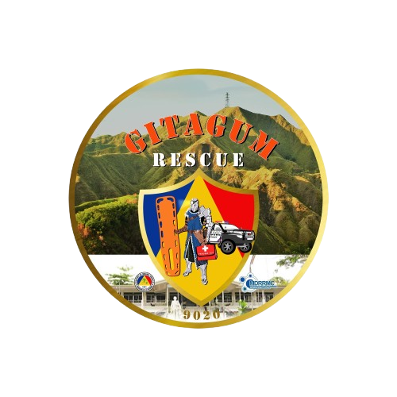

  

<h1 align="center">MDRRMO Gitagum</h1>

  <strong>Municipal Disaster Risk Reduction and Management Office</strong> 
  Municipality of Gitagum, Misamis Oriental, Philippines 
  <em>Handa. Ligtas. Matatag.</em>

---

## Emergency Hotlines

| Office | Number |
| --- | --- |
| **MDRRMO Rescue (24/7)** | **0975 840 3809** |
| MDRRMO Alternate Line | 0981 136 8638 |
| BFP Gitagum | 0966 994 9840 |
| PNP Gitagum | 0998 598 6952 |
| National Emergency Hotline | 911 |

**Email:** mdrrmcgitagum@gmail.com
**Facebook:** [MDRRMO Gitagum](https://www.facebook.com/profile.php?id=100089103559985)
**Office:** Municipal Hall, Poblacion, Gitagum, Misamis Oriental 9020

---

## About Us

The Municipal Disaster Risk Reduction and Management Office (MDRRMO) of Gitagum was established under **Republic Act No. 10121**, the Philippine Disaster Risk Reduction and Management Act of 2010. It leads the planning, coordination and implementation of disaster risk reduction programs in the municipality, working closely with the Municipal Disaster Risk Reduction and Management Council (MDRRMC), the barangays, and partner agencies.

Its response team, **Gitagum Rescue**, provides round-the-clock emergency response to residents and visitors.

### Vision

A safe, adaptive and disaster-resilient Gitagum where every family is prepared and every barangay is empowered.

### Mission

To reduce disaster risks and save lives through preparedness, timely warning, efficient response and sustainable recovery.

---

## Programs and Services

The MDRRMO's work follows the four thematic areas of disaster risk reduction and management: **prevention and mitigation, preparedness, response, and rehabilitation and recovery.**

- **Early Warning:** relays weather, flood and tsunami advisories from PAGASA and PHIVOLCS to every barangay.
- **Emergency Response:** 24/7 rescue, medical first response and patient transport.
- **Preparedness Training:** community drills, Basic Life Support, and water search-and-rescue training for schools and barangays.
- **Risk Assessment:** hazard mapping and vulnerability assessment of coastal, riverside and upland communities.
- **Evacuation Management:** pre-emptive evacuation and coordinated management of evacuation centers.
- **Rehabilitation and Recovery:** damage assessment, relief coordination, and support to help families recover and build back better.

---

## Be Prepared

### Typhoon
- **Before:** Monitor PAGASA bulletins and MDRRMO advisories. Secure your home and prepare your Go-Bag.
- **During:** Stay indoors and away from windows. Evacuate immediately when advised.
- **After:** Return home only when declared safe. Stay away from fallen power lines.

### Flood and Storm Surge
- **Before:** Know if your area is flood-prone. Keep important documents in waterproof bags.
- **During:** Move to higher ground. Never walk, swim or drive through floodwater.
- **After:** Avoid floodwater, which may be contaminated. Watch for signs of leptospirosis.

### Earthquake
- **Before:** Anchor heavy furniture. Join barangay and school earthquake drills.
- **During:** **DUCK, COVER and HOLD.** If you are near the coast, move to higher ground right away.
- **After:** Expect aftershocks. Check for injuries, gas leaks and fire.

### Fire
- **Before:** Never leave cooking unattended. Unplug appliances that are not in use.
- **During:** Crawl low under the smoke to the nearest exit. Stop, drop and roll if your clothes catch fire.
- **After:** Do not go back inside until the BFP declares it safe.

### Emergency Go-Bag Checklist
Keep a Go-Bag ready for each family member, with enough supplies for at least 72 hours:

- Drinking water (3 days)
- Ready-to-eat food
- First aid kit and medicines
- Flashlight and batteries
- Whistle
- Battery-powered radio
- Power bank and charger
- Copies of IDs and documents
- Cash in small bills
- Extra clothes and a blanket
- Hygiene kit and face masks
- Emergency contact list

---

## Barangays We Serve

Burnay · Carlos P. Garcia · Cogon · Gregorio Pelaez · Kilangit · Matangad · Pangayawan · Poblacion · Quezon · Tala-o · Ulab

---

  &copy; Municipal Disaster Risk Reduction and Management Office of Gitagum

